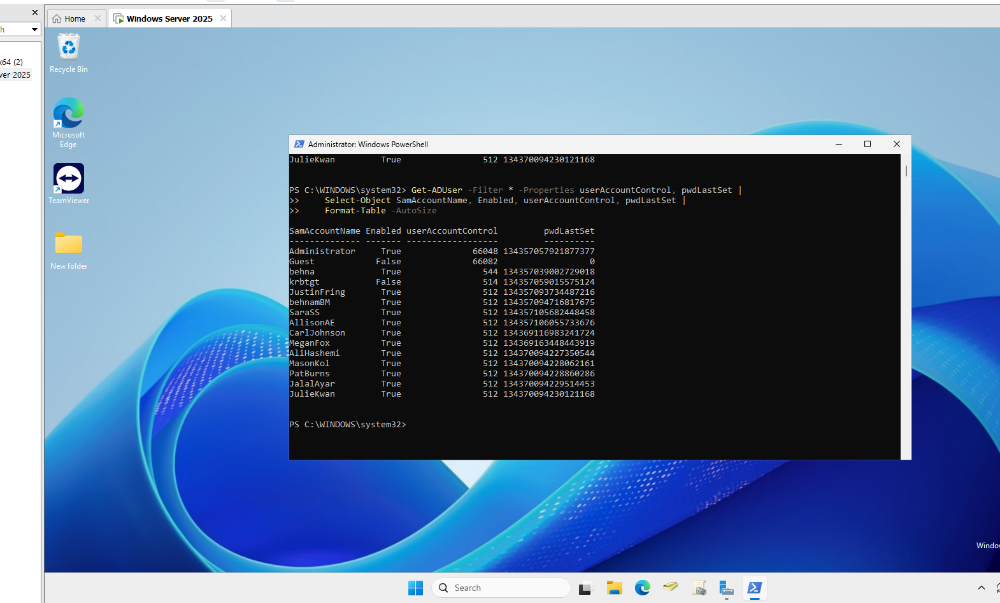
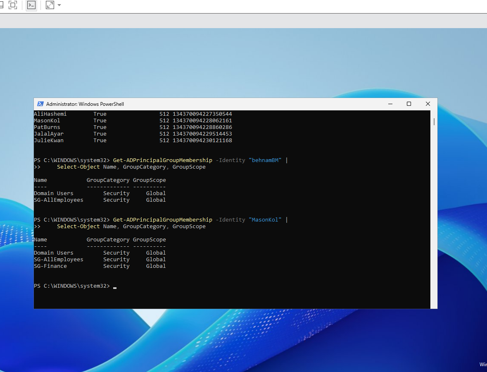
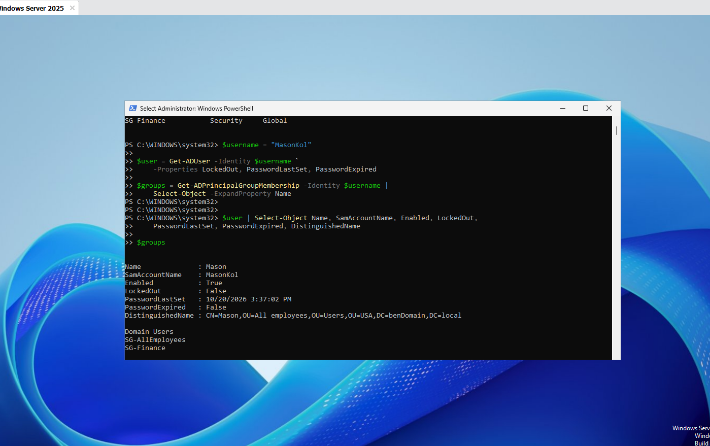
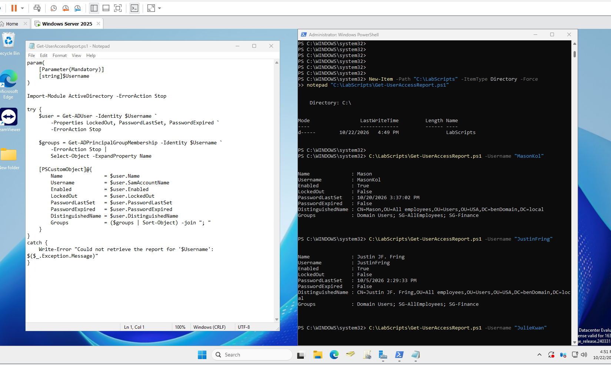
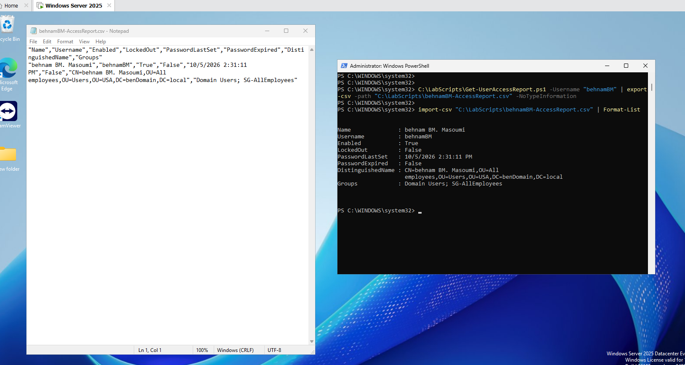

# Active Directory User Access Report

A PowerShell script that retrieves an Active Directory user's account status, password information, OU location, and group memberships. The script returns a structured object that can be displayed in the console or exported to CSV.

I built this tool to practice gathering account information for common help desk investigations, such as a user being unable to sign in or access a departmental folder.

## Environment

- Windows Server 2025 domain controller running in VMware
- Active Directory domain: `benDomain.local`
- Windows PowerShell with the `ActiveDirectory` module
- Existing lab users and departmental security groups

## Report Fields

| Field | Description |
| --- | --- |
| Name | Account name |
| Username | SAM account name |
| Enabled | Whether the account is enabled |
| LockedOut | Whether the account is locked out |
| PasswordLastSet | When the password was last set |
| PasswordExpired | Whether AD reports the password as expired |
| DistinguishedName | The account's directory path, including its OU |
| Groups | Group names returned by the membership query, sorted and separated by semicolons |

## Usage

Run the script from an account with permission to read the required AD attributes and group memberships. The Active Directory PowerShell module and connectivity to the domain are required.

In this lab, the script was saved in `C:\LabScripts`.

```powershell
C:\LabScripts\Get-UserAccessReport.ps1 -Username "MasonKol"
```

To explicitly display the result as a list:

```powershell
C:\LabScripts\Get-UserAccessReport.ps1 -Username "MasonKol" |
    Format-List
```

The script reads directory information without modifying accounts, passwords, or group memberships.

## Development and Verification

### 1. Verify Account Attribute Retrieval

I started by querying users and checking whether account attributes were returned correctly.

Some attributes initially appeared blank when querying under `BENDOMAIN\behna`. Repeating the queries using the domain Administrator account returned the values. This identified an account-dependent read-access issue in the lab; the underlying ACL configuration was not investigated further.

Administrator credentials were used for testing, but Domain Admin membership is not a requirement for the report. The querying account needs sufficient directory read permissions.



### 2. Verify Group Memberships

I used `Get-ADPrincipalGroupMembership` to compare two accounts.

- `behnamBM` returned `Domain Users` and `SG-AllEmployees`.
- `MasonKol` also returned `SG-Finance`.

This provided a departmental membership example for the report.

```powershell
Get-ADPrincipalGroupMembership -Identity "MasonKol" |
    Select-Object Name, GroupCategory, GroupScope
```



### 3. Collect Account Details and Group Names

I stored the user object and group names in separate variables. Additional account properties were requested with `-Properties`, and `Select-Object -ExpandProperty Name` extracted the group names.

```powershell
$username = "MasonKol"

$user = Get-ADUser -Identity $username `
    -Properties LockedOut, PasswordLastSet, PasswordExpired

$groups = Get-ADPrincipalGroupMembership -Identity $username |
    Select-Object -ExpandProperty Name
```



### 4. Build a Structured Report

I combined the results into a `[PSCustomObject]`. Sorting and joining the group names produced a single readable field suitable for CSV export.

```powershell
$report = [PSCustomObject]@{
    Name              = $user.Name
    Username          = $user.SamAccountName
    Enabled           = $user.Enabled
    LockedOut         = $user.LockedOut
    PasswordLastSet   = $user.PasswordLastSet
    PasswordExpired   = $user.PasswordExpired
    DistinguishedName = $user.DistinguishedName
    Groups            = ($groups | Sort-Object) -join "; "
}

$report | Format-List
```


### 5. Run the Reusable Script

I moved the queries into `Get-UserAccessReport.ps1` and added a mandatory `Username` parameter.

The script uses `-ErrorAction Stop` on the directory queries and a `try/catch` block to report lookup failures. Successful queries return the report object directly, allowing further pipeline processing.

I verified successful reports for `MasonKol` and `JustinFring`.



### 6. Test a Nonexistent Username

I tested error handling with an account that did not exist:

```powershell
C:\LabScripts\Get-UserAccessReport.ps1 -Username "NoSuchUser123"
```

The script reported that the account could not be found and returned to the PowerShell prompt without producing a report for that username.


### 7. Export and Read Back a CSV Report

I exported a report for `behnamBM`, opened the CSV in Notepad, and imported it back into PowerShell to verify its contents.

```powershell
C:\LabScripts\Get-UserAccessReport.ps1 -Username "behnamBM" |
    Export-Csv -Path "C:\LabScripts\behnamBM-AccessReport.csv" `
        -NoTypeInformation

Import-Csv "C:\LabScripts\behnamBM-AccessReport.csv" |
    Format-List
```

The original report object is passed directly to `Export-Csv`. `Format-List` is used only when displaying the imported data.



## Test Results

| Test | Result |
| --- | --- |
| Retrieve an existing user's account information | Account and password properties returned |
| Retrieve group memberships | Expected lab groups returned |
| Run the script with different usernames | Separate reports returned for existing users |
| Query a nonexistent username | Lookup error reported without a user report |
| Export a report to CSV | File created successfully |
| Import the CSV | Saved fields and values displayed successfully |
